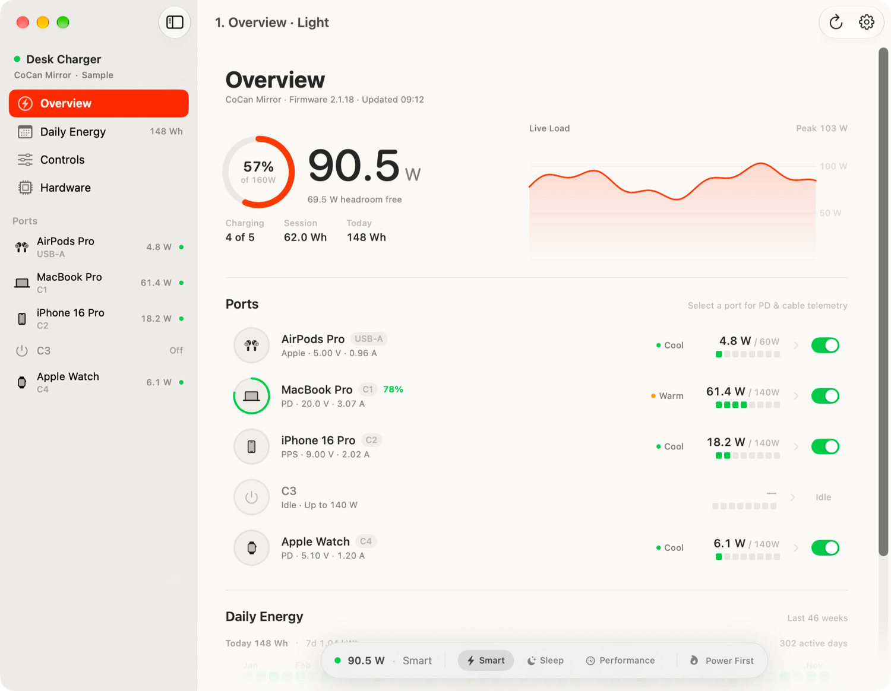
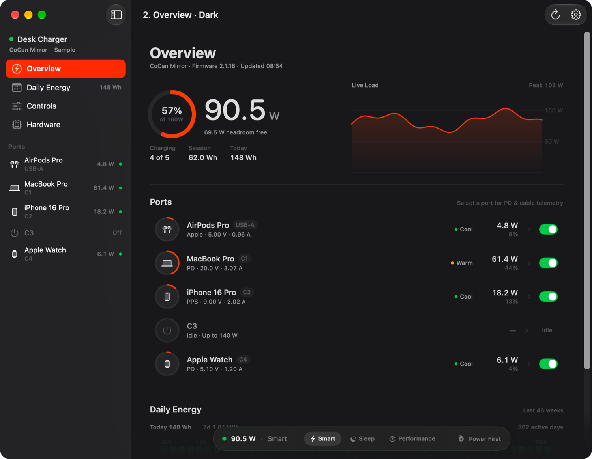
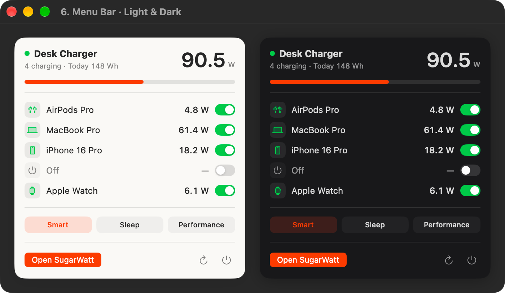
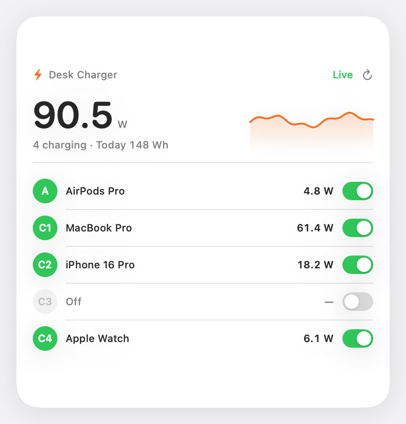
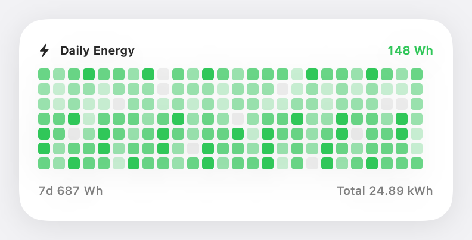
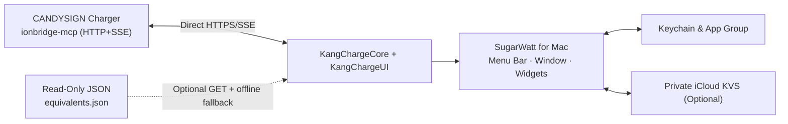

# SugarWatt (macOS)

**English** | [简体中文](README.zh-CN.md)

**A restrained, Apple-native macOS control center and desktop widget suite for CANDYSIGN (制糖工厂) CoCan / 小电拼 smart chargers.**

SugarWatt is an independent, MIT open-source app. It talks directly to your charger over CANDYSIGN's official MCP endpoint — no custom backend, no firmware flashing, and no third-party analytics.

> **Looking for iPhone & Apple Watch?** See [KangCharge-iOS](https://github.com/LeiZiKang/KangCharge-iOS) (free on the App Store, open source) and the shared [KangChargeCore](https://github.com/LeiZiKang/KangChargeCore) Swift Package.



## Features

- **Apple-native minimalist UI**: Light and Dark Mode support, restrained semantic colors, monospaced live power telemetry, and a smooth Swift Charts live load curve.
- **Per-port monitoring & control**: Live watts, voltage, current, fast-charge protocol, chip temperature, and safe power switches (confirms before turning off a charging port). Click any port for its 180-sample device memory log, USB PD negotiation, and cable E-Marker specs.
- **Daily Energy Heatmap**: GitHub-contribution-style daily charging energy grid powered by the charger's hardware `session_charge_mwh` counter — with optional iCloud Key-Value Store sync to SugarWatt for iOS.
- **Flexible Presence**: Choose to **Keep in Dock**, **Show in Menu Bar**, or both (at least one stays enabled; closing the window keeps background polling and energy logging running).
- **Compact Controls**: Charging modes (Smart, Sleep, Small Appliance, Performance, C1 Only), thermal policy, status display settings (CP-02S / Mirror), and temporary power allocation tucked neatly into a secondary Controls sheet.
- **Desktop Widgets**: Small, Medium, and Large live power widgets (with interactive port switches on Large) plus a dedicated **Daily Energy Heatmap** desktop widget.
- **Shortcuts & Updates**: Native App Intents for Shortcuts and a lightweight opt-in GitHub Releases update checker.

| Dark Mode | Menu Bar |
| --- | --- |
|  |  |

| Power Widget (Large) | Daily Energy Heatmap Widget |
| --- | --- |
|  |  |

## Architecture & How It Works



- **Zero relay backend**: Your MCP URL stays strictly in local Keychain; the Mac app polls your charger directly over HTTP+SSE.
- **Shared Swift Package**: Core protocol, `EnergyLedger`, and reusable SwiftUI components live in [KangChargeCore](https://github.com/LeiZiKang/KangChargeCore).
- **Simple read-only JSON**: Fun kWh comparisons are backed by a static JSON catalog ([`sugarwatt-equivalents`](https://github.com/LeiZiKang/sugarwatt-equivalents)) with full offline fallback.

See the full architecture & runtime walkthrough in **[KangChargeCore/ARCHITECTURE.md](https://github.com/LeiZiKang/KangChargeCore/blob/main/ARCHITECTURE.md)**.

## Requirements

- macOS 14 Sonoma or later
- A Wi-Fi connected CANDYSIGN CoCan charger paired in the CANDYSIGN app
- Your charger's **MCP server URL** (`https://mcp.thecandysign.com/<serial>/<token>/sse`)
- To build from source: Xcode 16+ and [XcodeGen](https://github.com/yonaskolb/XcodeGen)

## Build from Source

```bash
git clone https://github.com/LeiZiKang/KangCharge.git
cd KangCharge
brew install xcodegen
cp Config/Local.xcconfig.example Config/Local.xcconfig
```

Edit `Config/Local.xcconfig` with your Apple Developer Team ID and bundle ID prefix (a free personal team works):

```xcconfig
DEVELOPMENT_TEAM = ABCDE12345
BUNDLE_ID_PREFIX = com.yourname
```

Generate the Xcode project (which resolves [KangChargeCore](https://github.com/LeiZiKang/KangChargeCore) via Swift Package Manager) and run:

```bash
xcodegen generate
open KangCharge.xcodeproj
```

## Privacy & Security

- Your MCP URL contains your device serial number and access token. Treat it like a password.
- SugarWatt stores the URL strictly locally on your Mac (never committed to git, never sent to any third-party server).
- Daily energy history is stored locally in your App Group and optionally synced only through your private Apple iCloud Key-Value Store.

## Disclaimer

SugarWatt is not affiliated with, endorsed by, or sponsored by CANDYSIGN (制糖工厂). All trademarks belong to their respective owners.

## License

[MIT](LICENSE)
