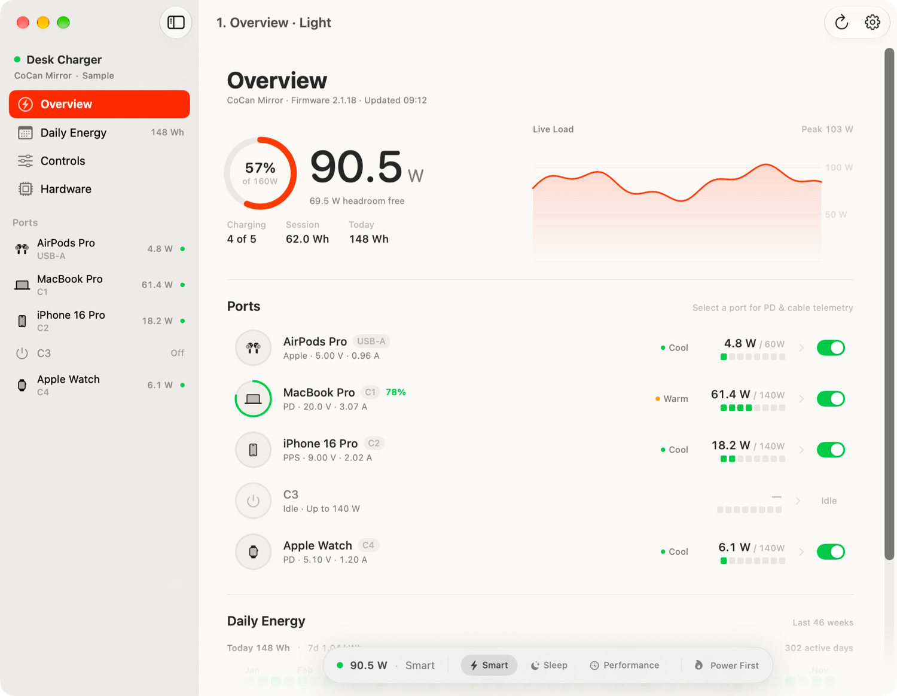

# SugarWatt (macOS)

[English](README.md) | **简体中文**

**为制糖工厂（CANDYSIGN）小电拼 CoCan 打造的克制 Apple 极简风 macOS 控制中心与桌面小组件。**

SugarWatt 是独立的 MIT 开源第三方应用，直接连接制糖工厂官方 MCP 接口，无自建后端、无需刷机、零第三方统计。

> **寻找 iPhone / Apple Watch 版？** 请见独立开源仓库 [KangCharge-iOS](https://github.com/LeiZiKang/KangCharge-iOS)（免费上架 App Store）与共享核心包 [KangChargeCore](https://github.com/LeiZiKang/KangChargeCore)。



## 功能亮点

- **克制 Apple 原生极简风**：完整支持浅色与深色模式、语义化系统色、等宽实时功率数字与平滑 Swift Charts 功率曲线，跟随系统语言自动切换中英文。
- **端口实时监控与安全控制**：实时功率、电压、电流、快充协议、芯片温度与通断开关（充电中关闭前二次确认）；点按端口可看设备内存 180 点历史曲线、USB PD 协商与线材 E-Marker 信息。
- **每日用电量热力图（GitHub 贡献图风格）**：基于硬件 `session_charge_mwh` 精确增量记账，悬停可查每日具体 Wh/kWh，并支持通过你的私有 iCloud KVS 与 iOS 版跨设备同步。
- **Dock 常驻 & 菜单栏自由开关**：在设置中自由开启/关闭「在 Dock 栏常驻」或「在菜单栏显示」（自动防呆保留至少一项入口），关闭窗口后仍在后台持续记录电量。
- **高级控制优雅收纳**：充电模式、温控策略、状态屏设置（亮度/屏显模式/待机动画/整点报时）与临时功率分配收纳在工具栏的二级控制弹窗，主界面保持清爽。
- **全新桌面小组件**：小 / 中 / 大三种实时功率小组件（大号可直接开关端口），以及专属的 **每日用电量方块热力图** 桌面小组件。
- **快捷指令与轻量更新检查**：支持系统 Shortcuts，并内置默认开启的 GitHub Releases 轻量版本检查。

## 从源码构建

```bash
git clone https://github.com/LeiZiKang/KangCharge.git
cd KangCharge
brew install xcodegen
cp Config/Local.xcconfig.example Config/Local.xcconfig
```

在 `Config/Local.xcconfig` 填入你的 `DEVELOPMENT_TEAM` 和 `BUNDLE_ID_PREFIX` 后运行：

```bash
xcodegen generate
open KangCharge.xcodeproj
```

## 隐私与安全

- MCP 地址包含设备序列号与访问令牌，请勿泄露。
- SugarWatt 仅在本机保存 MCP 地址，只与你填入的官方 MCP 服务器通信；每日用电量同步仅走你自己的 Apple iCloud。

## 开源协议

[MIT](LICENSE)
